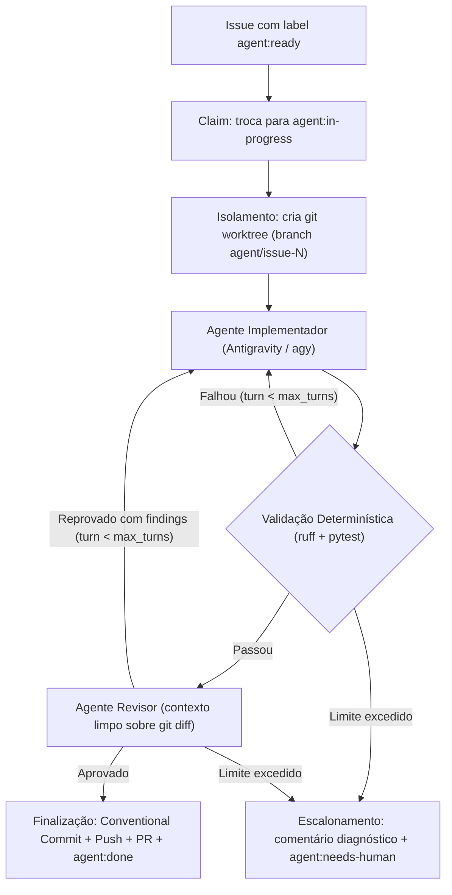
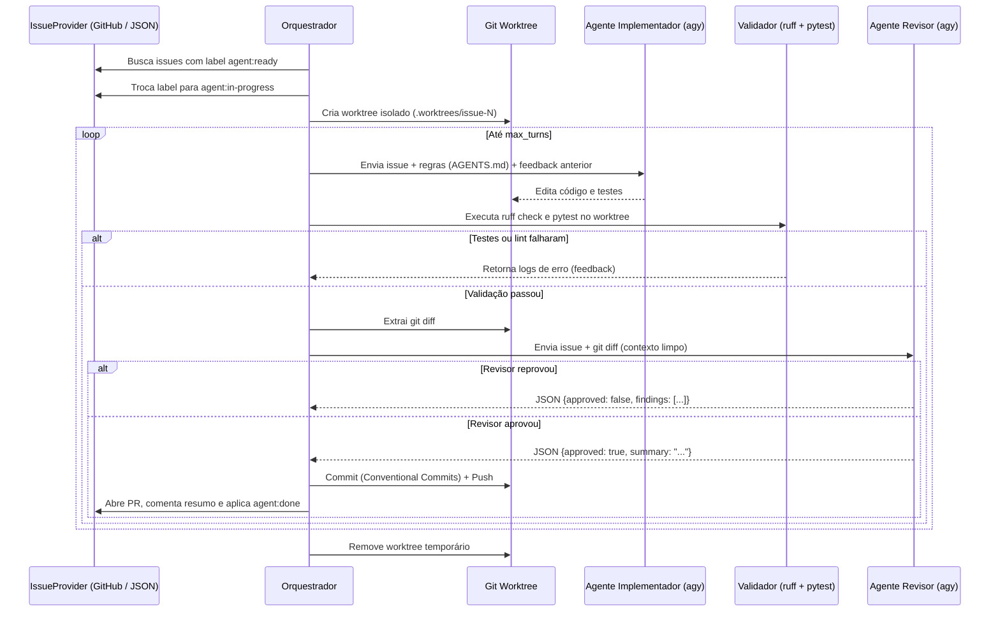

# Exemplo de Fábrica de Software Agêntica (v2)

> **Aviso**: Este repositório é um **exemplo didático e de referência** de uma **Fábrica de Software Agêntica v2** orientada a GitHub Issues. Ele demonstra na prática como estruturar um orquestrador de issues que dispara agentes para implementar, validar, revisar e finalizar entregas automaticamente.

Para fins de demonstração, a aplicação alvo é uma **API CRUD de Clientes (FastAPI)** simples e o executor padrão configurado é o **Antigravity (`agy`)**, com arquitetura extensível para outros agentes (`codex`, `claude`, etc.).

## Arquitetura v2

### Fluxo da Máquina de Estados



### Sequência de Execução entre Componentes



### Etapas em Resumo

1. **Trigger por Label**: O orquestrador busca issues com a label `agent:ready` e troca para `agent:in-progress`.
2. **Isolamento por `git worktree`**: Cada issue roda em `.worktrees/issue-<N>` na branch `agent/issue-<N>`.
3. **Agente Implementador**: Executa seguindo as regras do [`AGENTS.md`](AGENTS.md).
4. **Validação Determinística (Backpressure)**: Executa `uv run ruff check .` e `uv run pytest -q`. Se falhar, devolve o erro ao implementador.
5. **Agente Revisor (Contexto Limpo)**: Avalia o `git diff` + issue e retorna JSON estruturado (`approved`, `summary`, `findings`). Se reprovar, inicia retrabalho (até `--max-turns`).
6. **Finalização / Escalonamento**:
   - **Aprovado**: Commit em Conventional Commits, abertura de PR e label `agent:done`.
   - **Limite excedido**: Comentário diagnóstico na issue e label `agent:needs-human`.

## Como Rodar

### 1. Instalar dependências e rodar testes
```bash
uv sync
uv run ruff check .
uv run pytest -v
```

### 2. Subir a API CRUD de Clientes
```bash
uv run uvicorn app.main:app --reload
```
Documentação interativa em `http://127.0.0.1:8000/docs`.

### 3. Rodar a Fábrica em Modo Local (sem repositório remoto)
Teste todo o ciclo (incluindo `git worktree` real, `ruff`, `pytest` e revisão) usando `examples/local_issues.json` e o agente `mock`:
```bash
uv run python -m factory.orchestrator --provider local --agent mock
```

Ou usando o **Antigravity (`agy`)** localmente sobre o JSON de issues:
```bash
uv run python -m factory.orchestrator --provider local --agent antigravity
```

### 4. Rodar a Fábrica conectada ao GitHub Real
Pré-requisitos: repositório com remote `origin` configurado, `gh auth login` ativo e labels `agent:ready`, `agent:in-progress`, `agent:done`, `agent:needs-human` criadas no GitHub.
```bash
uv run python -m factory.orchestrator --provider github --agent antigravity --max-turns 3
```

## Extensibilidade para Outros Agentes (Codex, Claude, etc.)

Em [`factory/agents.py`](factory/agents.py), basta implementar uma subclasse de `AgentRunner` e registrá-la em `AGENT_REGISTRY`:
```python
AGENT_REGISTRY["codex"] = CodexAgentRunner
AGENT_REGISTRY["claude"] = ClaudeAgentRunner
```
